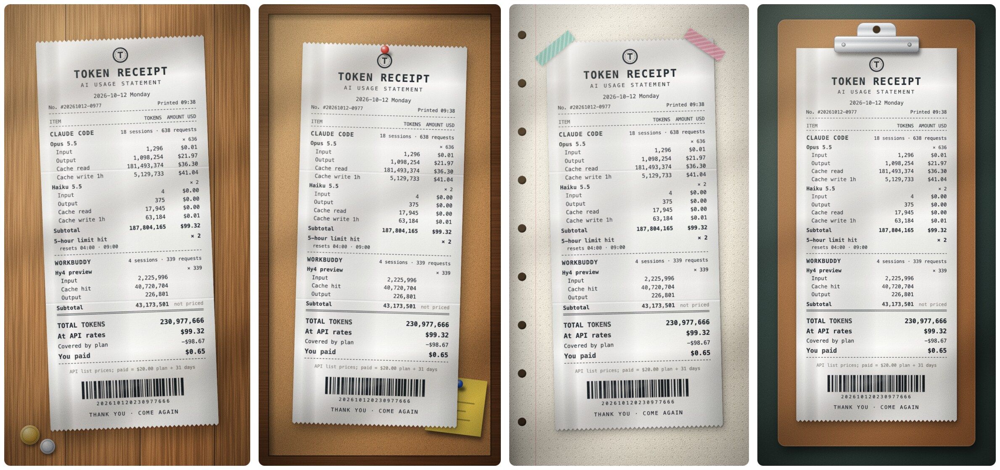

# Token Receipt

Turn a day of AI coding into a shop receipt.

Token Receipt reads the session logs that Claude Code, Codex and WorkBuddy keep on your computer and prints the day as a till receipt inside Obsidian: tokens by model, cache reads and writes, what it would have cost at API prices, and how much of your plan's limit you used. The receipt rolls out of a thermal printer, lands on a desk or gets pinned to a cork board. Copy it as an image, or save it and drop it into your daily note.

[中文说明](#中文说明)

That is the author's own day, as an animated SVG saved straight from the plugin.

## What is on the receipt

- **Claude Code**, one block per model: input, output, cache read and cache write tokens, each with its cost at API list prices, plus the number of sessions and requests.
- **Codex**, one block per model: input, cached input and output tokens, with costs for the models in the price table.
- **WorkBuddy**, one block per model: input, cache hit and output tokens. WorkBuddy has no public per-token price, so this block shows tokens only.
- **Plan limits.** When Claude Code tells you that you hit your 5-hour or weekly limit, it writes that message and the reset time into the session log; the receipt lists how many times that happened and when each limit resets. Codex logs the share of your limit you have used, so its block shows that percentage as of the last request of the day.
- **What you paid.** Set your monthly plan fees and the receipt divides them by the days in the month, shows that as the amount paid, and lists the difference from API prices as a discount line. Leave the fees at 0 to hide these lines.
- **Totals**, a barcode that encodes nothing, and a thank-you.

A tool you did not use that day gets no block.

## Scenes

The same receipt can be shown in six ways. They are drawn like a photo taken from above: paper grain and curl, soft shadows, thermal ink that fades and drops dots, wood and cork, a slant of window light. All of it is computed as SVG filters; the plugin ships no images.

- **Thermal printer**: the receipt feeds out of the slot line by line and ends with a burst of confetti.
- **Wooden desk**, **Cork board**, **Notebook and tape**, **Clipboard**: the receipt drops into place; pins and tape follow.
- **Plain**: a light background with no lighting, for when you only want the numbers.

The entrance animation plays in the sidebar and in animated SVG files. Saved images show the finished scene.

## Using it

Click the receipt icon in the ribbon, or run **Open receipt** from the command palette. The receipt opens in the right sidebar.

- The arrows and the date field move between days. A day runs from midnight to midnight in your local time zone.
- The dropdown picks the scene; the play button replays the entrance.
- While the view shows today, it recounts every few minutes.
- **Click the receipt** to enlarge it: the image is saved and opened in a new tab with Obsidian's image viewer.
- **Copy as image** puts a PNG on the clipboard.
- **Save as an image** writes `Token receipt-YYYY-MM-DD.webp` (or `.png`) to your attachment folder, or a folder you choose. Saving the same day again replaces the file.
- **Save as animated SVG** writes a looping `.svg` that animates wherever SVG images do, including notes and web pages.

Commands, none with a default hotkey:

- **Open receipt**
- **Save today's receipt as an image**
- **Insert today's receipt at the cursor**: saves the image and embeds it in the note you are editing.

## Settings

- **Receipt title**, **language** (the interface and the receipt follow Obsidian's language: Chinese for Chinese, English otherwise) and **scene**.
- **Monthly plan fees** for Claude and for Codex (ChatGPT), in US dollars.
- **Session folders** for Claude Code, Codex and WorkBuddy, if yours are not in the default place.
- **Image format, folder and resolution.** WebP is the default because textured scenes are several megabytes as PNG.
- **Price table**, as JSON, in US dollars per million tokens. Prices change and new models appear; edit the table to keep up. A model that is not in the table shows tokens without a cost. The Claude prices come from Anthropic's published rates; the OpenAI ones were taken from third-party price listings, so check them against your bill.

## Privacy and file access

- **Files outside your vault.** The plugin reads, and never writes, the session logs in `~/.claude/projects` (Claude Code), `~/.codex/sessions` and `~/.codex/archived_sessions` (Codex) and `~/.workbuddy/projects` (WorkBuddy). That is the only place the token counts exist, which is why the plugin needs them. It keeps only the token counts, model names, timestamps, session ids and limit information. Your prompts and the replies are never stored, shown or sent anywhere.
- **No network.** Nothing is sent anywhere. Costs are calculated from the price table in the settings.
- **Desktop only**, because it reads files through Node.js.
- The only things written to your vault are the images and SVG files you ask for.

## Limits of the numbers

- Only what is in the local logs is counted. Chats on claude.ai and in the Claude desktop app's chat tab are not there, although they draw on the same plan limits.
- For Claude the receipt can say that you hit a limit, not what percentage of it you used. That figure is not in the logs.
- If you use more than one account on the same computer, their sessions are counted together.
- Costs are estimates at API list prices. On a subscription you do not pay them.

## Installation

**From Community plugins** (once approved): search for “Token Receipt”.

**Manually:** download `main.js`, `manifest.json` and `styles.css` from the [latest release](https://github.com/MatsuriMW/token-receipt/releases/latest) into `<your vault>/.obsidian/plugins/token-receipt/`, then enable the plugin.

**With BRAT:** add `MatsuriMW/token-receipt`.

## Credits

The idea comes from [claude-receipts](https://github.com/chrishutchinson/claude-receipts) by Chris Hutchinson, which prints a receipt for each Claude Code session, on a real thermal printer if you have one. Token Receipt shares the idea and none of the code.

This plugin is not affiliated with Anthropic, OpenAI or Tencent.

## License

[MIT](LICENSE) © MatsuriMW

---

# Token 小票

把一天的 AI 编程用量打成一张购物小票。

Token 小票读取 Claude Code、Codex 和 WorkBuddy 存在本机的会话记录，在 Obsidian 里把这一天排成一张收银小票：按模型列出 token、缓存读写、按 API 标价折算的金额，以及订阅额度用了多少。小票会从热敏打印机里走出来，也可以落在桌上、钉在软木板上。可以复制成图片，也可以存下来贴进日记。

这是作者自己某一天的用量，是插件直接存出来的动画 SVG。

## 小票上有什么

- **Claude Code**：每个模型一栏，列出输入、输出、缓存读、缓存写的 token 和各自按 API 标价折算的金额，以及会话数和请求数。
- **Codex**：每个模型一栏，列出输入、缓存读、输出的 token；价目表里有的模型会算出金额。
- **WorkBuddy**：每个模型一栏，列出输入、缓存命中、输出的 token。WorkBuddy 没有公开的 token 单价，所以只列 token。
- **订阅额度**：Claude Code 提示 5 小时额度或周额度用满时，会把这条提示和重置时间写进会话记录，小票列出当天用满了几次、各自几点重置。Codex 的记录里有额度已用的百分比，小票印的是当天最后一次请求时的数字。
- **订阅实付**：填上订阅月费，小票按当月天数摊出当天实付，并把它和 API 标价的差额列成一行抵扣。月费填 0 就不显示这几行。
- **合计**、一个扫不出东西的条形码，和一句谢谢惠顾。

当天没用过的工具不占版面。

## 场景

同一张小票有六种摆法，都按俯拍静物照的样子做：纸的纤维和卷曲、柔和的投影、会褪色掉点的热敏墨迹、木纹和软木、一道斜着的窗光。这些全是用 SVG 滤镜算出来的，插件里不带任何图片。

- **打印机出纸**：小票从出纸口一行一行走出来，走完迸一把彩纸。
- **木桌**、**软木板**、**手账胶带**、**账单夹板**：小票落到位，图钉和胶带随后出现。
- **纯净**：浅色底，不加光影，只想看数字时用。

入场动效在侧边栏和动画 SVG 里播放，存下来的图片是定格后的画面。

## 怎么用

点左侧功能区的小票图标，或在命令面板运行「打开 Token 小票」，小票在右侧边栏打开。

- 箭头和日期框用来翻日期。一天按本机时区的 0 点到 24 点算。
- 下拉框选场景，播放按钮重放入场动效。
- 看今天的小票时，每隔几分钟自动重新统计。
- **点一下小票**可以放大：图片会存下来，并用 Obsidian 自带的图片查看器在新标签页里打开。
- 「复制成图片」把 PNG 放进剪贴板。
- 「存成图片」把 `Token小票-年-月-日.webp`（或 `.png`）存到附件文件夹，或你指定的文件夹。同一天再存一次会覆盖原来那张。
- 「存成动画 SVG」存一个循环播放的 `.svg`，嵌进笔记或网页里会动。

三个命令都没有默认快捷键：

- **打开 Token 小票**
- **把今天的小票存成图片**
- **把今天的小票插入到光标处**：存成图片，并嵌入正在编辑的笔记。

## 设置

- **小票抬头**、**语言**（界面和小票跟 Obsidian 的语言走：中文界面用中文，其他用英文）和**呈现方式**。
- Claude 和 Codex（ChatGPT）各自的**订阅月费**，单位美元。
- Claude Code、Codex 和 WorkBuddy 的**会话目录**，不在默认位置时改这里。
- **图片格式、存放文件夹和清晰度**。默认存 WebP，因为带纹理的场景存成 PNG 要好几 MB。
- **价目表**：JSON 格式，单位是美元 / 百万 token。价格会变，新模型会出，自己改表就行。不在表里的模型只列 token、不算金额。Claude 的价格来自 Anthropic 公布的标价；OpenAI 的几个取自第三方价目汇总，请对照自己的账单核对。

## 隐私和文件访问

- **读取库外文件**：插件只读、不写 `~/.claude/projects`（Claude Code）、`~/.codex/sessions` 和 `~/.codex/archived_sessions`（Codex）、`~/.workbuddy/projects`（WorkBuddy）里的会话记录。token 用量只存在这些文件里，所以必须读它们。插件只留下 token 数、模型名、时间、会话编号和额度信息；你的提问和模型的回答不会被保存、显示或发送到任何地方。
- **不联网**：不向任何地方发送数据，金额按设置里的价目表在本机计算。
- **仅桌面端**：读文件用的是 Node.js。
- 写进库里的只有你主动导出的图片和 SVG。

## 数字的边界

- 只统计本机记录里有的用量。claude.ai 网页版和 Claude 桌面版聊天标签的用量不在本机，但它们和 Claude Code 共用同一份订阅额度。
- Claude 这边，小票能告诉你额度用满过，但算不出用了百分之几，这个比例没有写进记录。
- 同一台电脑上用了多个账号的话，它们的会话会合在一起统计。
- 金额是按 API 标价折算的估算值，订阅用户并不实际支付这些钱。

## 安装

**社区插件市场**（审核通过后）：搜索「Token Receipt」。

**手动安装**：从[最新版本](https://github.com/MatsuriMW/token-receipt/releases/latest)下载 `main.js`、`manifest.json`、`styles.css`，放进 `<你的库>/.obsidian/plugins/token-receipt/`，然后启用插件。

**用 BRAT**：添加 `MatsuriMW/token-receipt`。

## 致谢

点子来自 Chris Hutchinson 的 [claude-receipts](https://github.com/chrishutchinson/claude-receipts)：它给每个 Claude Code 会话打一张小票，有热敏打印机的话还能真的打出来。Token 小票只借了这个点子，没有用它的代码。

本插件与 Anthropic、OpenAI、腾讯均无关联。
